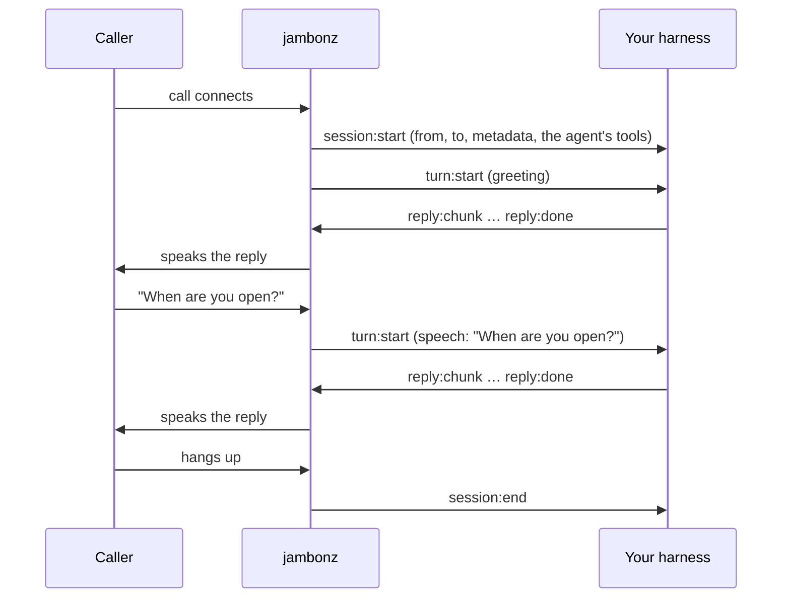

A **custom harness** agent is an Agent Studio agent whose thinking is done by a service you run. jambonz answers the
call, recognizes the caller's speech, decides when the caller has finished their turn, handles barge-in and speaks
your replies in the voice you choose. Your harness gets the caller's words as text, one turn at a time, and streams
back what to say.

Choose it when the logic of the conversation is yours to own: your own prompts and models, retrieval over your own
data, routing between procedures, checks on what gets said, or an agent framework you already use. If a prompt and a
set of tools are enough, a **cascaded voice pipeline** agent does that without any code.

## How a call works

jambonz opens **one WebSocket per call** to your harness's URL and keeps it open for the whole call.



| jambonz does | Your harness does |
|---|---|
| answers the call, speech recognition, turn-taking, barge-in, the voice | decides what to say each turn |
| runs the agent's tools from Agent Studio when you ask (`tool:call`) | calls models, runs its own tools, keeps whatever state it needs |
| transfers, hangs up and records when you ask | sends those commands |
| stores every turn, with your turn record, in the call history | describes each turn in its turn record |

Audio never goes to the harness. Everything on the socket is JSON text.

## What it takes

1. **A harness**, reachable at a `wss://` URL (or `ws://` on a private network with jambonz). The quickest start is
   the generator, which gives you a TypeScript project built on `@jambonz/sdk/harness`:

   ```bash
   npm create @jambonz/agent-harness@latest my-agent
   ```

   See the [quickstart](/agent-studio/custom-harness/quickstart).

2. **A Custom harness agent** in Agent Studio, with:
   - **Harness URL**: where jambonz connects. It is part of the agent, so it changes when you publish, like any other
     setting.
   - **Secret** (optional): sent as `Authorization: Bearer <secret>` when each call connects. It is saved in your
     jambonz account, never in the agent's settings or its exported file. Replacing it takes effect at once.
   - **Hear & speak**: the speech recognition and voice jambonz uses for the caller.

3. Optionally, **tools** on the agent. They are offered to your harness in `session:start`, and your harness runs them
   through jambonz, exactly as a pipeline agent's model would.

## When the harness is slow or down

In the Custom harness section, under **If the harness is slow or down**:

- **Wait for the first words**: how long jambonz waits after the caller's turn for the first `reply:chunk` (default
  4 seconds). After that it says the holding phrase once ("One moment.").
- **On failure**: if jambonz cannot connect, the connection drops and does not come back within 2 seconds, or two
  waits pass with no reply, it says a line and then hangs up or transfers the caller.

Every failure is recorded on the call: in the call history, the turn's record and the jambonz logs.

## What is recorded

Each turn in the call history has what the caller said and what the agent said. jambonz also records, for every turn:

- the time from the end of the caller's turn to your first `reply:chunk` (`latency.harness_first_chunk_ms`)
- the agent's tools your harness ran, with their results and round trips
- the **turn record** your harness sent with `reply:done`: which route the turn took, the steps with their timings,
  the model calls with tokens, flags and a note. See [the turn record](/agent-studio/custom-harness/protocol#the-turn-record).

These arrive on each turn's `turn_end` event, which your own application also receives on its `eventHook` when you
use the agent verb directly.

## Without Agent Studio

A harness works from any jambonz application. Use the [agent verb](/verbs/verbs/agent) with the harness as its LLM:

```json
{
  "verb": "agent",
  "stt": { "vendor": "deepgram", "language": "en-US" },
  "tts": { "vendor": "cartesia", "voice": "..." },
  "llm": { "vendor": "harness", "harness": { "url": "wss://harness.example.com" } },
  "actionHook": "/agent-done"
}
```

To send a secret, create an LLM credential with vendor `harness` through the jambonz API and name it with `label` on
the `llm` object.

## Next

- [Quickstart](/agent-studio/custom-harness/quickstart): a working harness on a test call in about 15 minutes
- [Protocol reference](/agent-studio/custom-harness/protocol): every message, for harnesses in any language
- [SDK reference](/agent-studio/custom-harness/sdk): `createHarness()`, its hooks and the per-call context
